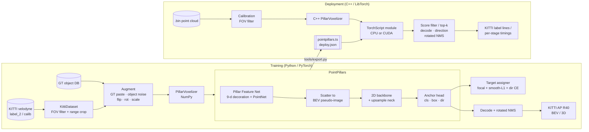

# DepthPillar

Real-time LiDAR 3D object detection on KITTI. DepthPillar fine-tunes a **PointPillars** detector in
PyTorch for cars, pedestrians and cyclists, evaluates it with KITTI-style AP|R40, and deploys it
through a **C++ inference pipeline**: voxelization in C++, the network in LibTorch (TorchScript),
then box decoding and rotated NMS in C++.

The project targets about 78% moderate-difficulty mAP (BEV, Car-dominated) after fine-tuning. The
numbers you get depend on your training schedule and on the starting checkpoint.
`tools/evaluate.py` prints the full per-class table.

## What's in here

| Part | Location | Notes |
|------|----------|-------|
| KITTI data layer | `depthpillar/data/` | label/calib/velodyne parsing, camera-FOV filter, GT-sampling database, augmentations |
| Pillar voxelizer | `depthpillar/ops/voxelize.py` | vectorized NumPy. Pillars are created in arrival order, with the same caps as the C++ version |
| Network | `depthpillar/models/` | Pillar Feature Net, BEV scatter, 3-stage backbone and upsampling neck, SSD anchor head |
| Training | `depthpillar/train.py`, `tools/train.py` | per-class BEV-IoU target assignment, focal + smooth-L1 (sin-difference) + direction loss, AdamW one-cycle, AMP, fine-tuning |
| Evaluation | `depthpillar/eval/`, `tools/evaluate.py` | KITTI AP\|R40 for BEV and 3D, Easy/Moderate/Hard. Writes KITTI-format result files |
| Export | `tools/export.py` | TorchScript (optionally ONNX) network core plus `deploy.json` |
| C++ inference | `cpp/` | `.bin` loader, calibration and FOV filter, voxelizer, LibTorch runner, decoding, rotated NMS, CLI, benchmark |

## Architecture



The exported network takes the voxelized tensors (`voxels [P,N,4]`, `num_points [P]`,
`coords [P,3]`) as input. That puts voxelization on the C++ side. The 9-dimensional point
decoration stays inside the traced graph, so Python and C++ always decorate points the same way.
Both voxelizers follow the same rules:

- Points outside the range are dropped.
- Pillars are allocated in the order their first point arrives.
- After `max_voxels` pillars, further pillars are ignored.
- After `max_points_per_voxel` points, further points in that pillar are ignored.

## Setup

```bash
python -m venv .venv && source .venv/bin/activate
pip install -e ".[dev]"          # torch, numpy, pyyaml, tqdm, tensorboard, pytest
```

Download the [KITTI 3D object detection](https://www.cvlibs.net/datasets/kitti/eval_object.php?obj_benchmark=3d)
data (velodyne, calib, label_2 and optionally image_2 for exact image sizes) into:

```
data/kitti/
  training/{velodyne,calib,label_2,image_2}/
  testing/{velodyne,calib,image_2}/
```

Then create the splits and the GT-sampling database:

```bash
# standard 3712/3769 split if you have the ImageSets files, otherwise a deterministic random split
python scripts/make_splits.py --root data/kitti [--split-dir path/to/ImageSets]
python scripts/create_gt_database.py --config configs/pointpillars_kitti.yaml
```

## How to run

**Train from scratch**

```bash
python tools/train.py --config configs/pointpillars_kitti.yaml
```

**Fine-tune from a pretrained PointPillars checkpoint.** Tensors that match by name and shape are
loaded. Head tensors whose shape differs because of a different class set are re-initialised.

```bash
python tools/train.py --pretrained weights/pointpillars_pretrained.pth \
    --set train.epochs=40 train.lr=0.001 train.freeze_backbone_epochs=2
```

Checkpoints (`last.pth`, `best.pth`) and TensorBoard logs are written to `runs/pointpillars_kitti/`.
Any config value can be overridden with `--set key.sub=value`.

**Evaluate**

```bash
python tools/evaluate.py --ckpt runs/pointpillars_kitti/best.pth --split val --out results/val
```

**Python single-frame inference**

```bash
python tools/infer.py --ckpt runs/pointpillars_kitti/best.pth \
    --bin data/kitti/training/velodyne/000008.bin --calib data/kitti/training/calib/000008.txt
```

**Export and run in C++**

```bash
python tools/export.py --ckpt runs/pointpillars_kitti/best.pth --out deploy        # add --fp16 on CUDA

cmake -S cpp -B cpp/build -DCMAKE_PREFIX_PATH="$(python -c 'import torch;print(torch.utils.cmake_prefix_path)')"
cmake --build cpp/build -j

# whole directory -> KITTI-format result files
./cpp/build/depthpillar_infer --model deploy/pointpillars.ts --deploy deploy/deploy.json \
    --input data/kitti/training/velodyne --calib-dir data/kitti/training/calib \
    --out results/cpp --device cuda

# latency benchmark (mean / p50 / p99 per stage, FPS)
./cpp/build/depthpillar_bench --model deploy/pointpillars.ts --deploy deploy/deploy.json \
    --input data/kitti/training/velodyne --frames 200 --warmup 20 --device cuda
```

If you omit `--fp16`, the TorchScript module is traced in FP32 on CPU, and it can still be loaded
onto CUDA with `--device cuda`. The C++ build needs CMake ≥ 3.18, a C++17 compiler and LibTorch.
It also needs network access the first time, to fetch `nlohmann/json`.

## How to test

```bash
# Python unit tests: voxelizer semantics, box transforms, rotated IoU/NMS,
# model forward/backward, export-wrapper parity, decoding, KITTI AP
pytest -q

# C++ unit tests: voxelizer caps/ordering, rotated IoU, NMS, anchors
cmake --build cpp/build --target depthpillar_tests && ctest --test-dir cpp/build --output-on-failure
```

None of the tests need the KITTI dataset or a GPU.

## Requirements and notes

- **Hardware:** training at full KITTI resolution needs an NVIDIA GPU with about 8 GB of memory
  for batch size 4. Inference and the tests also run on CPU.
- **Data:** KITTI is not redistributed. You need to accept its license and download it yourself.
- **Credentials:** none. Nothing in the pipeline calls an external service.
- No custom CUDA ops are used. Rotated IoU and NMS are implemented with convex polygon clipping,
  in NumPy for Python and in plain C++ for deployment.
