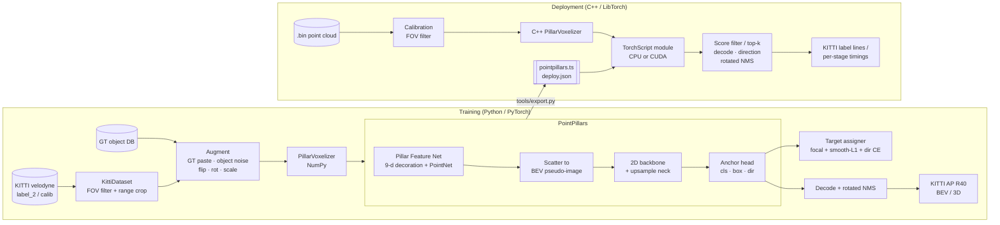
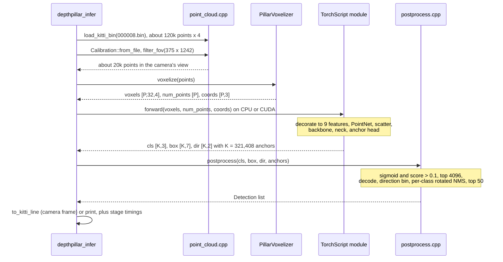

# DepthPillar

Real-time LiDAR 3D object detection on KITTI. DepthPillar fine-tunes a **PointPillars** detector in
PyTorch for cars, pedestrians and cyclists, evaluates it with KITTI-style AP|R40, and deploys it
through a **C++ inference pipeline**: voxelization in C++, the network in LibTorch (TorchScript),
then box decoding and rotated NMS in C++.

The project targets about 78% Car 3D AP|R40 at moderate difficulty after fine-tuning. BEV mAP
over all three classes comes out at around 70%. The numbers you get depend on your training
schedule and on the starting checkpoint. `tools/evaluate.py` prints the full per-class table
([example output](#example-output)).

## What's in here

| Part | Location | Notes |
|------|----------|-------|
| KITTI data layer | `depthpillar/data/` | label/calib/velodyne parsing, camera-FOV filter, GT-sampling database, augmentations |
| Pillar voxelizer | `depthpillar/ops/voxelize.py` | vectorized NumPy. Pillars are created in arrival order, with the same caps as the C++ version |
| Network | `depthpillar/models/` | Pillar Feature Net, BEV scatter, 3-stage backbone and upsampling neck, SSD anchor head |
| Training | `depthpillar/train.py`, `tools/train.py` | per-class BEV-IoU target assignment, focal + smooth-L1 (sin-difference) + direction loss, AdamW one-cycle, AMP, fine-tuning |
| Evaluation | `depthpillar/eval/`, `tools/evaluate.py` | KITTI AP\|R40 for BEV and 3D, Easy/Moderate/Hard. Writes KITTI-format result files |
| Export | `tools/export.py` | TorchScript (optionally ONNX) network core plus `deploy.json` |
| C++ inference | `cpp/` | `.bin` loader, calibration and FOV filter, voxelizer, LibTorch runner, decoding, rotated NMS, CLI, benchmark |

## Architecture



The exported network takes the voxelized tensors (`voxels [P,N,4]`, `num_points [P]`,
`coords [P,3]`) as input. That puts voxelization on the C++ side. The 9-dimensional point
decoration stays inside the traced graph, so Python and C++ always decorate points the same way.
Both voxelizers follow the same rules:

- Points outside the range are dropped.
- Pillars are allocated in the order their first point arrives.
- After `max_voxels` pillars, further pillars are ignored.
- After `max_points_per_voxel` points, further points in that pillar are ignored.

### A frame through the C++ pipeline



Tensor shapes for the default config (range 0 to 69.12 m by ±39.68 m, 0.16 m pillars):

| Stage | Shape | Notes |
|---|---|---|
| Raw scan | `[N, 4]` | x, y, z, reflectance. N is about 120k for a KITTI frame |
| Pillars | `[P, 32, 4]`, `[P]`, `[P, 3]` | P is at most 40,000 at eval time (16,000 in training) |
| Decorated points | `[P, 32, 9]` | adds offsets from the pillar mean (3) and the pillar centre (2) |
| Pillar features | `[P, 64]` | linear, BN, ReLU, max over points |
| BEV pseudo-image | `[1, 64, 496, 432]` | 432 × 496 grid of 0.16 m cells |
| Backbone stages | `[64, 248, 216]`, `[128, 124, 108]`, `[256, 62, 54]` | strides 2, 4, 8 |
| Neck | `[384, 248, 216]` | each stage upsampled to stride 2 with 128 channels, then concatenated |
| Head | `[321408, 3]`, `[321408, 7]`, `[321408, 2]` | 248 × 216 cells × 3 classes × 2 rotations |

## Setup

```bash
python -m venv .venv && source .venv/bin/activate
pip install -e ".[dev]"          # torch, numpy, pyyaml, tqdm, tensorboard, pytest
```

Download the [KITTI 3D object detection](https://www.cvlibs.net/datasets/kitti/eval_object.php?obj_benchmark=3d)
data (velodyne, calib, label_2 and optionally image_2 for exact image sizes) into:

```
data/kitti/
  training/{velodyne,calib,label_2,image_2}/
  testing/{velodyne,calib,image_2}/
```

Then create the splits and the GT-sampling database:

```bash
# standard 3712/3769 split if you have the ImageSets files, otherwise a deterministic random split
python scripts/make_splits.py --root data/kitti [--split-dir path/to/ImageSets]
python scripts/create_gt_database.py --config configs/pointpillars_kitti.yaml
```

## How to run

**Train from scratch**

```bash
python tools/train.py --config configs/pointpillars_kitti.yaml
```

**Fine-tune from a pretrained PointPillars checkpoint.** Tensors that match by name and shape are
loaded. Head tensors whose shape differs because of a different class set are re-initialised.

```bash
python tools/train.py --pretrained weights/pointpillars_pretrained.pth \
    --set train.epochs=40 train.lr=0.001 train.freeze_backbone_epochs=2
```

Checkpoints (`last.pth`, `best.pth`) and TensorBoard logs are written to `runs/pointpillars_kitti/`.
Any config value can be overridden with `--set key.sub=value`.

**Evaluate**

```bash
python tools/evaluate.py --ckpt runs/pointpillars_kitti/best.pth --split val --out results/val
```

**Python single-frame inference**

```bash
python tools/infer.py --ckpt runs/pointpillars_kitti/best.pth \
    --bin data/kitti/training/velodyne/000008.bin --calib data/kitti/training/calib/000008.txt
```

**Export and run in C++**

```bash
python tools/export.py --ckpt runs/pointpillars_kitti/best.pth --out deploy        # add --fp16 on CUDA

cmake -S cpp -B cpp/build -DCMAKE_PREFIX_PATH="$(python -c 'import torch;print(torch.utils.cmake_prefix_path)')"
cmake --build cpp/build -j

# whole directory -> KITTI-format result files
./cpp/build/depthpillar_infer --model deploy/pointpillars.ts --deploy deploy/deploy.json \
    --input data/kitti/training/velodyne --calib-dir data/kitti/training/calib \
    --out results/cpp --device cuda

# latency benchmark (mean / p50 / p99 per stage, FPS). --calib-dir applies the same
# camera-FOV filter as depthpillar_infer; without it the whole 360-degree scan is timed.
./cpp/build/depthpillar_bench --model deploy/pointpillars.ts --deploy deploy/deploy.json \
    --input data/kitti/training/velodyne --calib-dir data/kitti/training/calib \
    --frames 200 --warmup 20 --device cuda
```

If you omit `--fp16`, the TorchScript module is traced in FP32 on CPU, and it can still be loaded
onto CUDA with `--device cuda`. The C++ build needs CMake ≥ 3.18, a C++17 compiler and LibTorch.
It also needs network access the first time, to fetch `nlohmann/json`.

## Example output

Illustrative, not a recorded run. These numbers show the format each tool prints and the
rough values to expect: 80 epochs from scratch on the 3712/3769 split, on a single RTX 3080
with an 8-core CPU. Your numbers will vary with the schedule, the seed and the hardware.

**Training** (`tools/train.py`, 928 iterations per epoch at batch size 4, logged every 50
steps):

```
2026-06-05 09:12:04,511 INFO epoch 0 iter 0/928 loss 4.5743 (cls 0.8923 box 1.7716 dir 0.6941) 1.4s
2026-06-05 09:12:22,087 INFO epoch 0 iter 50/928 loss 2.9827 (cls 0.6418 box 1.1032 dir 0.6727) 18.9s
2026-06-05 09:12:39,640 INFO epoch 0 iter 100/928 loss 2.4306 (cls 0.5274 box 0.8865 dir 0.6512) 36.5s
...
2026-06-05 09:17:31,229 INFO epoch 0 done: {"loss": 2.1055, "cls_loss": 0.4987, "box_loss": 0.7412, "dir_loss": 0.6219, "num_pos": 38.6142}
...
2026-06-05 17:03:46,902 INFO epoch 79 iter 888/928 loss 0.6714 (cls 0.1874 box 0.2296 dir 0.1238) 314.2s
2026-06-05 17:04:00,415 INFO epoch 79 done: {"loss": 0.6875, "cls_loss": 0.1912, "box_loss": 0.2351, "dir_loss": 0.1306, "num_pos": 39.2087}
```

`loss` is `1.0·cls + 2.0·box + 0.2·dir`. `num_pos` is the average number of positive anchors
per batch. Every 5 epochs the trainer also logs a `val epoch N: {...}` line with every AP key,
and it keeps `best.pth` by `mAP_3d_moderate`.

**Evaluation** (`tools/evaluate.py --split val`, 3769 frames):

```
class       metric        easy  moderate      hard
Car         bev          91.84     87.62     85.09
Car         3d           87.31     78.06     75.12
Pedestrian  bev          61.27     55.83     51.40
Pedestrian  3d           56.42     50.91     46.37
Cyclist     bev          84.95     66.18     62.04
Cyclist     3d           81.09     62.47     58.66
mAP         bev          79.35     69.88     66.18
mAP         3d           74.94     63.81     60.05
latency (network + postprocess): 27.6 ms/frame
```

| Class | IoU threshold | 3D AP\|R40, moderate | BEV AP\|R40, moderate |
|---|---|---|---|
| Car | 0.70 | 78.1 | 87.6 |
| Pedestrian | 0.50 | 50.9 | 55.8 |
| Cyclist | 0.50 | 62.5 | 66.2 |
| **mAP** | | **63.8** | **69.9** |

**C++ inference on one frame** (`depthpillar_infer --input .../000008.bin --calib-dir ... --device cpu`,
without `--out`). On CPU the network dominates:

```
000008: 7 detections (196.482 ms)
  Car         0.912  x=14.83 y=-1.02 z=-0.83 l=3.87 w=1.63 h=1.52 yaw=-0.03
  Car         0.887  x=22.41 y=3.52 z=-0.78 l=4.12 w=1.69 h=1.58 yaw=1.55
  Car         0.854  x=7.62 y=-4.96 z=-0.91 l=3.71 w=1.58 h=1.47 yaw=-1.60
  Car         0.731  x=33.05 y=-7.18 z=-0.72 l=3.95 w=1.62 h=1.55 yaw=-0.06
  Pedestrian  0.618  x=11.37 y=6.24 z=-0.65 l=0.79 w=0.62 h=1.74 yaw=1.48
  Cyclist     0.412  x=26.80 y=8.91 z=-0.70 l=1.74 w=0.58 h=1.71 yaw=0.12
  Car         0.236  x=47.93 y=10.64 z=-0.55 l=3.82 w=1.60 h=1.49 yaw=3.11
frames=1  voxelize 1.91 ms | upload 0.05 ms | network 189.86 ms | post 4.66 ms | total 196.48 ms
```

Boxes are in the LiDAR frame (x forward, y left, z up, z at the box centre). With `--out`,
the same detections are written as KITTI label lines in the camera frame instead.

**C++ latency benchmark on CUDA** (`depthpillar_bench --frames 200 --warmup 20 --device cuda`),
first with `--calib-dir` and then without it:

```
stage           mean ms     p50 ms     p99 ms
voxelize           1.42       1.39       2.07
upload             0.36       0.34       0.58
network            6.91       6.88       7.64
postprocess        2.85       2.71       5.12
total             11.54      11.36      14.27
throughput: 86.7 FPS (device=cuda, frames=200, fov=camera)
```

```
stage           mean ms     p50 ms     p99 ms
voxelize           2.63       2.58       3.71
upload             0.71       0.69       1.02
network            8.12       8.07       9.10
postprocess        3.40       3.22       6.35
total             14.86      14.65      17.94
throughput: 67.3 FPS (device=cuda, frames=200, fov=full)
```

### How the metrics are computed

`depthpillar/eval/kitti_eval.py` is a NumPy port of the matching logic in the official
devkit (`evaluate_object.cpp`):

- **Overlap.** BEV IoU is rotated-rectangle intersection over union. 3D IoU multiplies the
  BEV intersection by the vertical overlap. A detection matches when IoU > 0.7 for Car and
  > 0.5 for Pedestrian and Cyclist.
- **Difficulty.** Easy, Moderate and Hard set a minimum 2D box height (40, 25, 25 px), a
  maximum occlusion (0, 1, 2) and a maximum truncation (0.15, 0.3, 0.5). Harder ground
  truths, and the neighbouring class (Van for Car, Person_sitting for Pedestrian), are
  *ignored*: they are never false negatives, and detections matched to them are never
  false positives. Detections whose projected 2D box is too short are ignored the same way.
- **AP|R40.** Score thresholds are chosen from the true-positive scores so that recall
  steps evenly. Precision is interpolated at 40 recall points (1/40 … 1) using the best
  precision at or above each recall, then averaged and multiplied by 100.
- **mAP.** The mean of the class APs for each metric and difficulty. A class with no valid
  ground truth in the split reports `nan` and is left out of the mean.

### Reading the numbers

- **Moderate is the headline column.** KITTI ranks on it. Easy is mostly close, unoccluded
  objects, and Hard adds heavily occluded and truncated ones.
- **BEV is always at least 3D.** BEV ignores height, so a box with the right footprint but a
  wrong z still counts.
- **Car scores highest even with the strictest threshold.** Cars are large and reflective,
  so they have plenty of points. Pedestrians cover only a few 0.16 m pillars and are easily
  confused with poles and trunks.
- **Python and C++ latency measure different things.** `evaluate.py` times network plus
  postprocess only, because voxelization runs in the DataLoader workers. Its NMS is NumPy, so
  it is slower than the C++ path. `depthpillar_bench` times all four stages.
- **Without `--calib-dir` the benchmark times extra work.** The full scan has about twice as
  many pillars as the camera view, and that shows up in voxelize, upload and the PFN. The
  dense BEV backbone costs the same either way, so the network stage grows the least.
- **AP doesn't see heading flips.** Rotated IoU is the same for a box turned by 180°, so a
  weak direction classifier shows up in `dir_loss` and in the KITTI `alpha`/`ry` fields, not
  in AP.

| Symptom | Likely cause | What to try |
|---|---|---|
| A class has AP 0.00 but others look fine | Anchor size or `z` doesn't fit the class, or `score_threshold` is too high for it | Check the `anchors` entry for that class; lower `postprocess.score_threshold` |
| Pedestrian and Cyclist AP far below Car | GT sampling disabled or the GT database is missing | Run `scripts/create_gt_database.py`; check `gt_sampling.enabled` |
| `checkpoint is missing N tensors` from `evaluate.py` | The checkpoint was trained with a different class list or backbone | Evaluate with the training config, or fine-tune with `--pretrained` |
| C++ and Python detections differ | `deploy.json` exported from another config, or FOV/image size mismatch | Re-export with the same `--config`; pass `--img-h/--img-w` for non-standard images |
| `fp16 export requires a CUDA device` | A `--fp16` export loaded with `--device cpu` | Export without `--fp16` for CPU |
| `postprocess` p99 far above its mean | Many anchors above `score_threshold`, so NMS runs on up to 4096 boxes | Raise `score_threshold` or lower `nms_pre_max` |
| Loss is `nan` early in training | AMP overflow at a high learning rate | Lower `train.lr` or set `train.amp=false` |

## How to test

```bash
# Python unit tests: voxelizer semantics, box transforms, rotated IoU/NMS,
# model forward/backward, export-wrapper parity, decoding, KITTI AP
pytest -q

# C++ unit tests: voxelizer caps/ordering, rotated IoU, NMS, anchors
cmake --build cpp/build --target depthpillar_tests && ctest --test-dir cpp/build --output-on-failure
```

None of the tests need the KITTI dataset or a GPU.

## Design decisions

| Decision | Choice | Rationale |
|---|---|---|
| Detector | PointPillars | One dense 2D backbone over a BEV pseudo-image, with no sparse or 3D convolutions, so it runs in real time and deploys anywhere LibTorch does |
| Export boundary | Voxelize outside the graph, decorate inside it | Pillar construction is data-dependent and fast in plain C++. The 9-feature decoration is traced, so Python and C++ can't drift apart |
| Voxelizer semantics | Arrival-ordered pillars with fixed caps, identical in NumPy and C++ | Both implementations follow, and are unit-tested against, the same ordering and cap rules, so the deployed model sees the same pillars it was trained on |
| Rotated IoU / NMS | Convex polygon clipping in NumPy and plain C++ | No custom CUDA ops, so it builds on any machine. NMS runs on at most 4096 pre-filtered boxes, so it stays cheap |
| Runtime | TorchScript in LibTorch, with ONNX as an option | Same kernels as training and an optional FP16 path, while ONNX remains available for other runtimes |
| Assignment and losses | Per-class BEV-IoU anchor matching, focal loss, smooth-L1 on sin-difference, direction CE | The standard SECOND/PointPillars recipe. The sin-difference removes the 180° ambiguity from regression, and the direction bin restores the heading |
| Augmentation | GT copy-paste with collision checks, object noise, global flip/rotate/scale | Rare classes appear in far more scenes, which matters most for Pedestrian and Cyclist |
| Metric | AP\|R40 with devkit-style ignore rules | Matches the official KITTI benchmark, so numbers are comparable with published results |

## Requirements and notes

- **Hardware:** training at full KITTI resolution needs an NVIDIA GPU with about 8 GB of memory
  for batch size 4. Inference and the tests also run on CPU.
- **Data:** KITTI is not redistributed. You need to accept its license and download it yourself.
- **Credentials:** none. Nothing in the pipeline calls an external service.
- No custom CUDA ops are used. Rotated IoU and NMS are implemented with convex polygon clipping,
  in NumPy for Python and in plain C++ for deployment.
